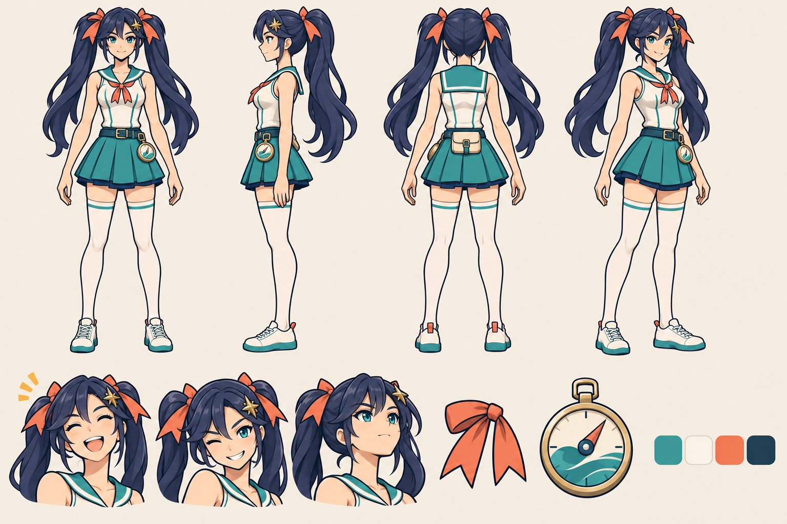
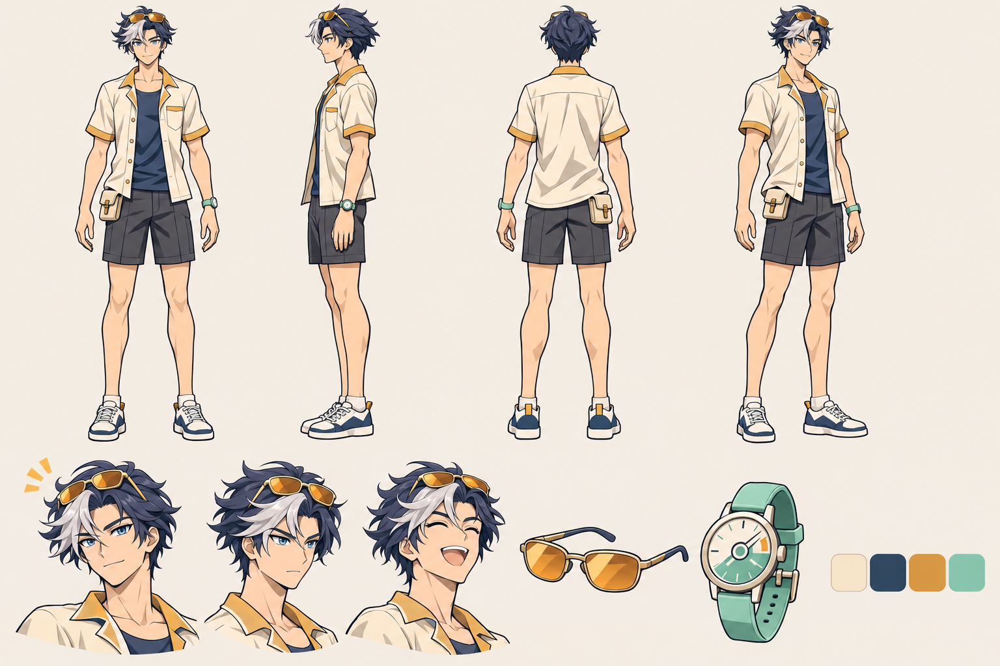
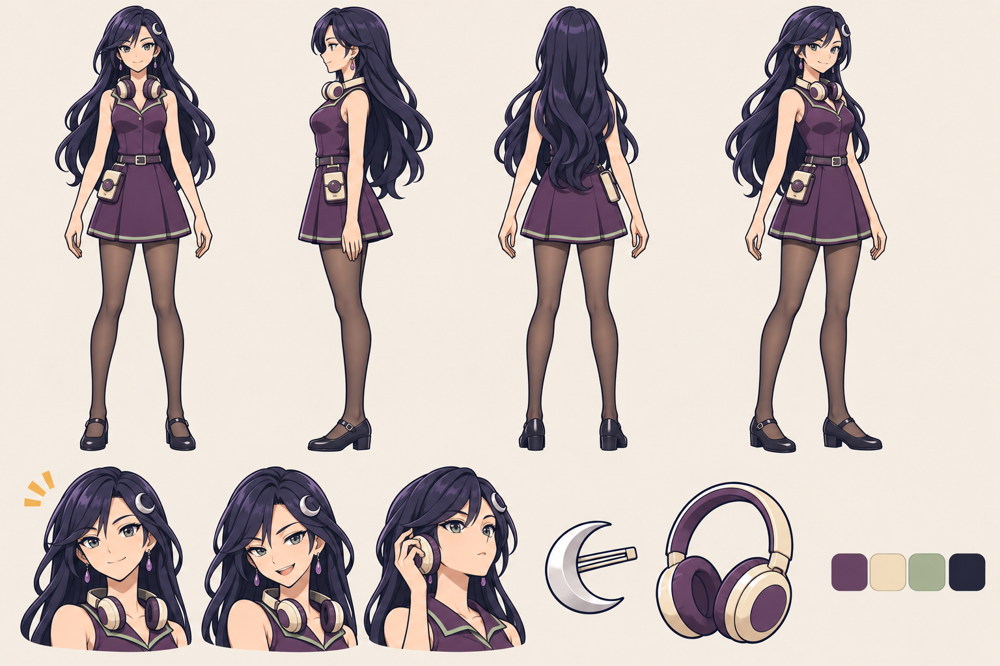
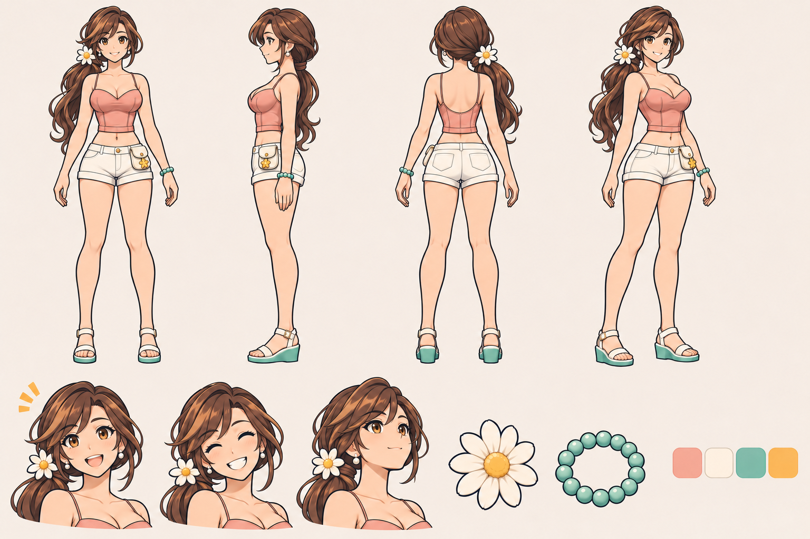

# 原创训练师：浮岬调查队

四位原创人类训练师，**全部为 18 岁成年人**。当前造型方向为 **summer-v2**：日式角色审美、白皙自然的肤色、年轻清爽的面容与夏装；澄汐为白丝双马尾美少女，夜苇为黑丝御姐，朔野为少年系大帅哥，夏晴为温柔明亮的邻家姐姐。御姐感来自身高、眼神、姿态与穿搭，不用成熟年龄、浓妆或职业装表达。后续原创角色也沿用白皙肤色和亚洲审美，以造型、性格与辨识度作设计依据，不设置人口构成配额。

四人的 `lobby`、`cutin` 与 `portrait` 已统一从夏装透明全身源图导出，夏晴另外提供全身和头像剪影。发布尺寸、裁剪位置与哈希在 `public/art/trainers/<id>/provenance.json`，制作记录在 [runtime-summer-v2-generation.json](runtime-summer-v2-generation.json)。原始 `turnaround.png`、第一版发布源图与 `runtime-v1-provenance.json` 保留；夏晴当前设定为 `turnaround-summer-v3.png`，其余三人为 `turnaround-summer-v2.png`。

## 共同背景

浮岬群岛的旧航路不断受潮汐、野生宝可梦迁徙与废弃设施影响。三个人临时组队，准备画出一份「让人和宝可梦都能安全通过」的新地图。澄汐负责找路，朔野负责让装备运转，夜苇负责判断什么时候应该绕路。三人都能独立作为主角或重要 NPC 使用。

## 01 · 澄汐 / Chengxi

**18 岁，女性，164 cm；海岸领航员。关键词：明亮、俏皮、迎风双马尾。**

- **来历与目标**：在摆渡码头长大，熟悉礁石之间的水道。曾因过分相信旧海图，险些把同伴带入涨潮后的死路。从那以后，她开始记录只有步行者和小型宝可梦才能使用的岸线，希望完成群岛第一份会随季节更新的安全路线图。
- **性格与缺点**：开朗，观察敏锐，习惯先试再说；紧张时会变得格外爱开玩笑。她总说「我先去看看」，却不擅长承认自己需要帮助。
- **训练方式**：偏好水、飞行属性；用节奏清楚的短哨和手势协调队伍，擅长借地形、潮水与风向改变站位。每次探索前都先演练撤退路线，对伙伴的疲劳格外敏感。
- **脸与头发**：暖象牙色肤色、清亮青绿眼睛，精致而有表情的成年少女脸；深靛蓝高双马尾垂至后腰，发梢轻轻内弯，额前碎刘海。两侧珊瑚红燕尾旗形发结是首要识别点，左额角配一枚小黄铜罗盘星发夹。
- **服装与轮廓**：约 6.5–7 头身，双马尾形成舒展的上部轮廓，高腰短裙接修长双腿。白色无袖水手领感上衣，青绿窄滚边与胸前短珊瑚结；海盐青百褶短裙，深蓝窄下摆，裙内有不外露的安全短裤。薄白色过膝长袜，袜口一条窄青线；白青低帮运动鞋。肩臂露出，夏装轻薄。
- **标志装备**：本人左髋一枚黄铜青绿潮汐罗盘，腰后中央一个小奶油色地图包。发结、双马尾、罗盘形成三个层级的识别点；不堆叠挂件。
- **配色**：潮绿 `#2C9F9A`、奶白 `#F7F6EF`、珊瑚橙 `#F27C55`、深海军蓝 `#18384E`。
- **动作与表情**：平时前脚掌轻点地；指路时整个身体先朝前倾。表情重点为露齿笑、眯眼判断风向、被同伴识破逞强后的尴尬笑。
- **口头禅**：「先看风，再出发。」
- **成长弧线**：从「替所有人探路」到「愿意让别人带自己走一段」。

**多视图锁定**：两条高马尾与红发结、左额角星形发夹、左髋罗盘、腰后中央地图包、裙长与白色过膝袜高度一致。配件左右按本人定义。

## 02 · 朔野 / Shuoye

**18 岁，男性，186 cm；野外维修师。关键词：清爽、俊朗、少年意气。**

- **来历与目标**：在家人的山间索道站学会检修。一次停电时，他与伙伴用最简单的机械工具帮忙完成救援，于是开始第一次独立旅行，沿路修复避难棚、路标和补给设备。他相信一条路真正开放，是因为最后一个走过它的人也能平安回来。
- **性格与缺点**：耐心，话少，擅长照顾人；喜欢一本正经地讲冷笑话。遇到故障会忘记时间，有时宁愿修好坏掉的东西，也不愿承认该放手。
- **训练方式**：偏好电、钢属性；重视防守、掩护和稳定配合，训练中先练停机与脱离指令，再练输出。会为不同体型的伙伴制作休息支架和保护垫，不把伙伴当电源使用。
- **脸与头发**：自然暖米色肤色，灰蓝眼睛、挺直鼻梁、清晰但不宽厚的下颌与利落眉眼；蓝黑色蓬松短发向后侧梳，额前本人右侧一束银白挑染。无胡须与面部年龄纹，笑容松弛，是年轻清爽的少年系帅哥。
- **服装与轮廓**：约 7–7.5 头身，宽肩窄腰、修长而有运动感。奶油白短袖开襟夏衬衫，领内与袖边一点赭金，内搭贴身石板蓝背心；炭灰剪裁工装短裤止于膝上，口袋平整。低帮白蓝运动鞋，短袜。衣服有空气感，不用长裤和厚靴。
- **标志装备**：琥珀色镜片墨镜架在头顶；本人左腕为小型薄荷绿检测腕表，右髋是一只紧凑折叠工具包。银白额发与琥珀墨镜在头像尺寸仍可识别。
- **配色**：奶油白 `#F4E8CB`、石板蓝 `#304D67`、赭金 `#DCA441`、薄荷绿 `#8ED1BA`。
- **动作与表情**：站姿松弛、肩部舒展，抬手扶正墨镜后再开口；做事时目光收紧，确认修好东西后扬起一侧嘴角。表情重点为自信浅笑、专注、开怀笑。
- **口头禅**：「能修。先坐下喝口水。」
- **成长弧线**：从只相信自己修好的东西，到相信别人也能接住他的失误。

**多视图锁定**：本人右侧银白额发、头顶墨镜、左腕腕表、右髋工具包保持一致；袖长、膝上裤长、敞开的薄衬衫保持一致。

## 03 · 夜苇 / Yewei

**18 岁，女性，175 cm；夜行生态记录员。关键词：清冷、从容、锋芒。**

- **来历与目标**：曾在旧广播站整理野外录音，发现很多被人当作「怪声」的声音其实是宝可梦的交流信号。她开始沿旧通信线路旅行，建立夜间声景档案，找出人类道路与野生栖地发生冲突的位置。
- **性格与缺点**：内向但不怯弱，观察细致，偶尔会突然说一句很锐利的实话。她对细微变化极敏感，却常因为想收集到「足够证据」而错过行动时机。
- **训练方式**：偏好草、幽灵属性；擅长隐蔽接近、状态配合与场地控制。先让伙伴熟悉环境和声音，再练协同；对陌生宝可梦优先保持距离，通过重复的温和信号建立信任。
- **脸与头发**：冷调瓷白肤色、灰绿杏眼、稍扬的细长眼尾，面部年轻精致、无年龄纹或凹陷面颊；乌紫长发垂至腰臀间，发梢略卷，侧分长刘海露出一侧眉眼。本人左侧银色月牙发夹，一对短小紫晶耳坠，气质自信、从容，避免浓妆。
- **服装与轮廓**：约 7 头身，修长、腰线鲜明。深桑葚紫无袖收腰短连衣裙，小折领与浅 V 领，窄腰带、轻微 A 字裙摆，裙长在大腿中段。薄透黑色连裤丝袜，黑色单带低方跟玛丽珍鞋。肩臂露出，使用薄夏装面料，避免西装式职业装。
- **标志装备**：奶油色与紫色的紧凑圆形监听耳机松放在锁骨附近；本人右髋一只小型录音机包。月牙发饰、耳机与黑丝长腿构成清晰识别点；裙装结构简洁。
- **配色**：桑葚紫 `#614664`、乌紫 `#242334`、鼠尾草绿 `#A6B9A0`、暖奶油 `#EEE2C6`。
- **动作与表情**：听见新声音时先侧头，一手轻按耳机；指挥时目光稳定、手势简洁。表情重点为从容浅笑、抬眉看穿对方、侧耳专注。
- **口头禅**：「等一下，它还没说完。」
- **成长弧线**：从只愿意记录世界，到愿意主动改变自己听见的困境。

**多视图锁定**：左侧月牙发夹、成对紫晶耳坠、颈部耳机、右髋录音机包、长发长度、裙长与黑丝透明度保持一致。黑丝必须读作薄丝袜，不画成厚打底裤。设定图中左侧面将录音包画在近侧，第三表情的抬手耳机与颈部耳机结构重叠；后续正式立绘和建模需按文字锁定项整理。

## 三人的关系

- 澄汐总想把路线画得更远，朔野总在她的背包里多放一份补给；她嫌他啰嗦，却从没把那份补给拿出来。
- 朔野习惯用机器读数判断故障，夜苇往往先凭声音听出问题。两人会争论原因，却总能一起找到解法。
- 夜苇会让澄汐「再等三分钟」，澄汐则会拉她离开已经记录了十遍的现场。两人分别提醒对方何时该停、何时该走。

## 04 · 夏晴 / Xiaqing

**18 岁，女性，170 cm；海岸饲育员。关键词：亲切、明亮、雏菊、夏日曲线。**

- **来历与目标**：住在海岸补给站旁，从小帮助邻居照料宝可梦。第一次外出旅行时，她把日常照料的耐心带到队伍中，希望找到适合人和伙伴一起歇脚的海边小路。
- **性格**：温柔爱笑，会主动关心同伴，也敢大方地表现自己；鼓励时自然亲近，行动时不拖泥带水。
- **脸与头发**：白皙暖象牙肤色、蜜棕眼睛，年轻柔和的面容；栗棕长发在本人右侧扎低侧马尾，发结上方一朵白色黄芯雏菊，一对小珍珠耳钉。
- **服装与轮廓**：约 7 头身，胸腰比例和自然圆润的臀部轮廓鲜明。蜜桃色细肩带贴身短上衣，较低心形领口与露背剪裁，露出腰腹；白色高腰贴身短裤，整洁卷边；白色与薄荷绿低坡跟凉鞋。全部面料不透，前、侧、背面关键部位保持完整遮盖，不以透衣或走光表现清凉。
- **标志配饰**：右侧雏菊与侧马尾、左腕薄荷珠串、左髋奶油色小包与黄色花饰。
- **配色**：蜜桃 `#E9A09C`、暖白 `#FFF8ED`、薄荷 `#8FBBAF`、暖黄 `#F2CC78`。姓名和对白面板使用对比度更高的蔷薇色 `#C66F79`。
- **解锁定位**：通过游玩获得的新训练师；规则唯一来源为 [progress-save 增量规范](../../../openspec/changes/add-trainer-presentation/specs/progress-save/spec.md)，数字与判断读取 `src/trainers.ts`，累计进度使用既有 `Progress.kills`。
- **多视图锁定**：本人右侧马尾与雏菊、左腕手链与左髋小包，细肩带、心形领口、露腰和短裤长度一致。

原始方案、服装调整与完整提示词见 [夏晴生成记录](xiaqing/generation.json)。

## 设定图规范

- 每人一张独立横向角色设定图，统一暖白底、深海军蓝描线、二至三层赛璐璐明暗、大块面简化材质；适合后续转译为低多边形 3D。
- 每张上方为四个同尺寸全身视图，从左到右：正面、人物左侧面、背面、前方三分之四。中立站姿，双臂略离躯干，双脚与头顶留有空白。
- 每张下方为三个表情头像、两处装备特写及无文字色板；不画场景与宝可梦，保持人类角色的识别与结构清楚。
- 18 岁成年日式冒险游戏角色比例，约 6.5–7.5 头身；澄汐较灵动，夜苇和朔野更修长，统一描线和明暗语言。三人均为夏装，腿部服饰为薄袜，不增加厚外套、围巾、长袖或冬靴，不用老成面部刻画增加角色差异。
- 原始生成图保留；逐图检查多视图、完整性与主要设计一致性。图像仍是概念参考，局部配件与真实建模结构以文字锁定项为准。

夏装版提示词与输出信息见同目录的 `summer-v2-generation.json`；第一版完整记录保留在 `generation.json`。角色素材分别存入 `chengxi/`、`shuoye/`、`yewei/`，后续表情与演出立绘继续放入对应角色目录。共享画风规则由 `STYLE.md` 维护。

## 透明立绘导出

`python3 assets/concepts/original-trainers/prepare.py` 读取 `runtime-summer-v2-generation.json`，为四人生成统一来源的全身、切入、头像和夏晴剪影。

- 原始 `runtime-summer-v2.png` 保留；`runtime-summer-v2-clean.png` 是清理后的透明源图。
- 这些赛璐璐人物本体不透明：以 alpha ≥224 为实体，保留外沿一像素抗锯齿，去掉远离实体的低透明雾；边缘颜色取邻近实体色，防止原背景残色形成白边。这一规则不用于烟雾或透明特效。
- 全身按有效 alpha 外框裁切，等比缩至高 1400；不裁头、手和鞋。切入 768×768、头像 256×256，采用各自人工确认的裁剪框、底部 4px 透明边。
- 剪影复用完整立绘的 alpha，填深海蓝；不保留脸部与服装色彩细节。
- 透明结果须在浅底和深底检查，再在正式 GPU 页面核对；素材抠图与宿主 alpha 合成各自验收。
