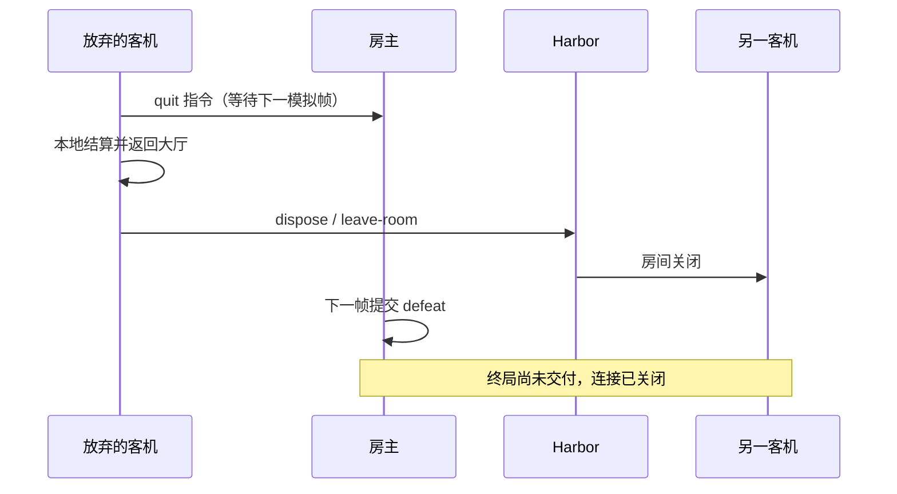

# 全应用隐式状态机地图

初次盘点基线：2026-11-08，`bae88fa1d34e70bcae4f2c86f434379d0436b700`。本清单从源码追踪“前一步发生了什么，会改变后一步允许做什么”的流程：不仅是 `phase` / `status` 枚举，也包括散落的布尔值、当前对象引用、Promise、序号、timer、集合和资源句柄。

这是实现地图，未引入状态机框架。2026-11-08 本批修复以 `09eb4a0027dcb7602789d0f3b6e1d705d87ad1c6` 为基线，本文和相关分册仅按工作区源码差异更新受影响段落；旧扫描计数、行号和源哈希仍是初次盘点的定位记录，不代表全量重审。契约见 [OpenSpec](../openspec/specs/)。文档更新未运行产品测试或设备检查；结算/背包接线和网络整合的最终审阅仍由主线程收尾。状态名字是为阅读提炼的逻辑名称，不一定是代码中的枚举。

## 领域清单

| 领域                                               | 范围与入口                                                              |
| -------------------------------------------------- | ----------------------------------------------------------------------- |
| [应用与 GPU UI](state-machines/application-ui.md)  | 页面/过场、run controller、窗口、焦点、手势、异步导入、图鉴和大厅       |
| [联机与 Harbor](state-machines/network.md)         | 房间、连接/重连、传输选择、地图/就绪屏障、所有权、时钟、终局与离房      |
| [资源、渲染与音频](state-machines/resources.md)    | prepare句柄、缓存、预热、字体分页、context generation、帧调度、声音请求 |
| [玩法与模拟](state-machines/simulation.md)         | world、玩家、选卡/成长、交互、区域、敌人/守卫、招式/必杀与实体寿命      |
| [平台、输入与存储](state-machines/platform.md)     | 两端设备身份、回中、按键重武装、文本/文件、启动退出、持久化及开发服务   |
| [画面反馈与分析工具](state-machines/view-tools.md) | 角色/效果/实例生命周期、画面缓存、诊断记录与平衡模型阶段                |

初次索引粒度：应用/UI84项（字体详解转引用）、网络35项、资源81项（含消费者索引）、模拟118项（含家族/分支）、平台20个编号、画面/分析71项（含只读投影）。平台 PL-06 的震动发送机制已移除，仅保留稳定编号说明，其余编号不重排。各领域存在有意的交叉引用，不能相加为独立FSM数量。

每项给出所有者和实际状态编码、逻辑状态及转换、触发/守卫、取消/失败/终态、关键不变量，以及已有测试或证据缺口。重复的技能、动画和实例按共享生命周期归为家族，具体分支仍列出源码入口。纯数值曲线不是每个粒子一台状态机。

## 为什么不能只看 `status`

一个 `ended=true` 只表示某个对象认为自己结束，不代表它拥有的所有跨层工作都交付完成。以下保留审计时客机主动退出的**历史失败顺序**：本地结果已生成，房主还没消费退出指令，Harbor却已经收到销房请求。它说明为什么需要跨层追踪，不代表修复后的当前顺序。

原审计用真实临时Harbor和三个WebSocket会话复现此顺序，并追踪正式App回调；未实跑正式页面点击。当前网络协议 8 已增加 quit/terminal/terminal-ack 的终局保留、确认与离房交付处理，具体转换由主线程在 [网络分册](state-machines/network.md) 收尾，本次文档更新未重跑该复现。清单中的不变量需结合当前条目阅读。

## 最需要联动理解的边界

| 边界                        | 当前实际编码与风险                                                  |
| --------------------------- | ------------------------------------------------------------------- |
| UI失败 → 世界是否推进       | host fatal 回调先 dispose 应用会话，再报告平台错误                  |
| 本地结束 → 终局交付 → 离房  | 已增加 terminal/ack 与退出意图保留；网络分册待主线程收尾            |
| 可选持久化 → 核心连接清理   | 凭据读写错误独立报告 warning，清理继续；网络终态由主线程审阅        |
| 业务完成 → 正式存档确认     | 未保存 result 留存重试；onStarted 成功后才激活世界，待最终审阅      |
| 异步请求 → 发起页面仍存在   | import 成败核对 screen/runLayer、暂停 codexHome revision 及宿主存活 |
| 可绘制 → 可输入             | activeTarget 共用；syncInputOwner 在按下与采样前同步，保护首个按压  |
| 已解析 → 正式缓存拥有资源   | canonical 准备抛错时，loader dispose 尚未移交的 LoadedModel         |
| 缓存请求 → 取消/重试        | 失败 held 项移除并释放；音乐 applying 按 hold 身份去重              |
| 缓冲保留范围 → 播放时钟     | 已增加历史裁剪标记与播放时钟恢复；网络分册待主线程收尾              |
| 活跃导航 → 快照恢复         | 保存 mobility 类，恢复完整机动语义；导航也校验有限数据              |
| 环境状态 → 死亡结算归属     | source=-1 转 null killer，保留基础掉落/区域奖励，无个人击杀收益     |
| 道具“存在” → 初始化效果完成 | 背包骰子先按本局 RNG 取得一级 fx，再计算初始满生命/护盾             |

真正值得收敛的是这些已经产生不同结果的归属和提交边界。简单的 `ready/disposed` 或计时器在局部足够清楚时可以保留；没有理由把每项改成类、全局状态仓库或统一状态机引擎。

## 覆盖方法与限制

初次盘点按 `src/` 的428个TS/TSX模块所在领域分工，扫描状态字段、事件注册、异步完成、取消/销毁和主要调用者；进一步读取跨模块转换，使用独立审阅和故障对照挑战结论。Harbor、原生文件sheet及与应用相接的开发服务/构建也纳入。该方法与下列覆盖限制保留为初次盘点说明，不是本次定向文档更新的新执行记录。

这不是“428个文件逐行形式化证明”，也不声称枚举所有布尔组合。领域页明确记录读取入口、归并家族和未逐项检查的部分。静态内容表、类型声明、纯数学/几何/布局函数、没有跨调用记忆的校验器、单纯插值曲线，不单列为机器；它们参与的阶段仍在所属条目说明。第三方库、浏览器/驱动内部状态、资产生成服务和CI平台内部状态不属于应用源码清单。

测试文件引用表示存在相关保护，**不表示覆盖该项全部转换**；只有明确运行过的检查才算本次执行。合成SDL事件、替代GPU部件、内存传输、受控候选和真实本机Harbor有不同证据边界；没有将它们升级为物理设备、WAN或完整自然成长验收。

## 后续维护

改变异步完成、失败、取消、加载屏障或退出顺序时，更新对应条目的状态/所有者与关联OpenSpec场景。修缺陷时优先测试实际会伤害玩家的转换，例如“确认放弃后立即dispose”“保存失败后尝试重开”“切页完成后旧import才返回”，避免只断言flag名字、mock调用次数或常量。

新状态只在现有条目无法表达新的行为所有者时再单列；不因多一个布尔字段自动增加机器。发布记录仍保留测试日期和源码基线，已知缺陷修复后新增证据，不改写本次历史复现成仿佛一直正常。
